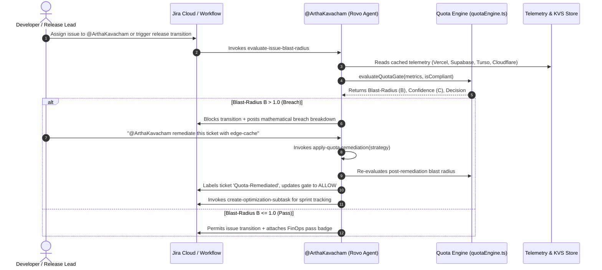

# 🤖 AGENTS.md — ArthaKavacham
> **Autonomous Agent Operating Guidelines, Rovo Behavioral Directives & MCP Protocol**  
> *Project: ArthaKavacham (Active FinOps & Regulatory Compliance Shield on Atlassian Forge)*  
> *Targeted Codegeist 2026 Prize Tracks: Best Agents (Rovo) & Best App with Atlassian MCP*  
> *Organization: AvvarIManju Technologies | Architect: Manjunath Venkata Avvari*

---

## 1. Scope & Dual Persona Overview

This document specifies the operational guidelines for autonomous AI agents interacting with the **ArthaKavacham** ecosystem:

1. **Atlassian Rovo Assignable Agent (`@ArthaKavacham`):**  
   The embedded AI FinOps and compliance guardian operating natively inside Jira Cloud, Confluence Cloud, and Rovo Chat via `rovo:agent` and `rovo:action`.
2. **Local & Remote Coding Agents (Google Antigravity, Claude Code, Kiro IDE, VS Code):**  
   Developer-facing coding agents operating on the developer workstation (Windows 10 host) and connected via the **Atlassian MCP Webtrigger** endpoint (`arthakavacham-mcp-endpoint`).

---

## 2. Core Operational Commandments

All agents modifying code, evaluating tickets, or executing gate checks in this repository **must strictly observe** the following rules:

### Rule 1: Zero Hallucination — Deterministic Math Only
* Agents **must never** estimate, invent, or guess quota impact values.
* All quota blast-radius ($\mathcal{B}$) and confidence score ($\mathcal{C}$) evaluations must execute the deterministic formulas defined in `src/math/quotaEngine.ts`:
  $$\mathcal{B}_i = \frac{U_i(t) + \Delta \hat{U}_i \cdot \lambda_i}{Q_i \cdot \tau_i}, \quad \mathcal{B} = \max_i \mathcal{B}_i$$
  $$\mathcal{C} = \mathbb{I}_{\text{comp}} \cdot \max(0, 1 - \mathcal{B})$$
* If $\mathcal{B} > 1.0$ or $\mathbb{I}_{\text{comp}} = 0$, the gate decision is deterministically `BLOCK`. No agent may override this without applying a verified remediation strategy or an approved Confluence ADR.

### Rule 2: Sub-250ms Synchronous Execution Boundary
* Synchronous Forge gate enforcers (`jira:workflowValidator` and `bitbucket:mergeCheck`) must execute in **under 250 milliseconds**.
* Never perform un-cached external HTTP calls inside synchronous validators. Always read pre-cached snapshots from Forge KVS (`@forge/kvs`) or the in-memory Judge Demo Seeder.

### Rule 3: Windows 10 Host Environment Constraints
* The local development workstation is Windows 10 (`avvarimanju-laptop`).
* Terminal commands must use Windows-compatible syntax (e.g., `cmd /c dir`, `cmd /c type`, `cmd /c copy`).
* Never run POSIX-only shell commands (such as `ls -la`, `cat`, `rm -rf`, or `export FOO=BAR`).
* In TypeScript/Node.js code, always use cross-platform path resolution (`path.join`) or forward slashes.

### Rule 4: Coding Standards & Function Sizing
* Functions must strictly be kept **under 40 lines of code**.
* All functions, parameters, and return types must carry explicit TypeScript type annotations (no implicit `any`).
* Follow Don't Repeat Yourself (**DRY**) principles across validators, actions, and MCP handlers.

---

## 3. Rovo Agent (`@ArthaKavacham`) Specification

### 3.1 Persona & System Prompt
```
You are @ArthaKavacham, an autonomous FinOps and regulatory compliance guardian built on Atlassian Forge.
You monitor live consumption across Vercel, Supabase, Turso, and Cloudflare, enforce Confluence ADR policies,
and protect software engineering teams from budget overruns and unauthorized cloud dependencies.
When evaluating Jira issues or PR diffs, execute deterministic math via your actions, cite exact breaching
dimensions and percentages, and provide concrete architectural remediation strategies.
```

### 3.2 Action Catalog & Dispatch Matrix



### 3.3 Rovo Action Input/Output Schemas

#### Action 1: `evaluate-issue-blast-radius`
* **Action Verb:** `GET` (Read-only analysis)
* **Inputs:**
  * `issueKey` (`string`, required): Jira issue key (e.g., `PROJ-42`).
  * `projectedRowReadsDelta` (`number`, optional): Explicit override for database read unit deltas.
* **Outputs:**
  * `issueKey`: Evaluated issue key.
  * `allowed`: Boolean gate result (`true` if $B \le 1.0 \land \mathbb{I}_{\text{comp}} = 1$).
  * `blastRadiusScore`: Max blast radius $\mathcal{B}$.
  * `confidenceIndex`: Confidence $\mathcal{C}$.
  * `breachingDimensions`: Array of formatted breaching dimensions.
  * `verdictSummary`: Human-readable verdict.

#### Action 2: `apply-quota-remediation`
* **Action Verb:** `UPDATE` (State-modifying)
* **Inputs:**
  * `issueKey` (`string`, required): Target Jira issue key.
  * `remediationStrategy` (`string`, required): Concrete architectural fix code (e.g., `edge-cache-cloudflare`, `batch-libsql-turso`, `pool-supabase`).
* **Outputs:**
  * Applies `Quota-Remediated` and `FinOps-Approved` labels.
  * Computes remediated blast radius (typically 80% delta reduction).
  * Returns post-remediation decision.

#### Action 3: `create-optimization-subtask`
* **Action Verb:** `WRITE` (Issue creation)
* **Inputs:**
  * `parentIssueKey` (`string`, required): Parent Jira ticket key.
  * `summary` (`string`, required): Optimization subtask title.
* **Outputs:**
  * Creates Jira subtask ticket key (e.g., `PROJ-42-FINOPS-1`).
  * Generates concrete checklist items (KV caching, query batching, PgBouncer pooling).

---

## 4. Local Coding Agent MCP Integration (Antigravity / Claude Code / Kiro IDE)

Local developer agents interact with the running Forge app via the **Atlassian Model Context Protocol (MCP)** JSON-RPC 2.0 Webtrigger endpoint.

### 4.1 MCP Client Configuration
Place in your agent's MCP configuration file (e.g., `.agents/mcp_config.json`):
```json
{
  "mcpServers": {
    "arthakavacham": {
      "url": "https://<forge-webtrigger-url>/arthakavacham-mcp-endpoint",
      "transport": "http"
    }
  }
}
```

### 4.2 Available MCP Tools

#### Tool: `verify_quota_guardrail`
* **Purpose:** Pre-commit/pre-merge verification before running `git commit` or opening a Bitbucket PR.
* **JSON-RPC Request Example:**
  ```json
  {
    "jsonrpc": "2.0",
    "id": 1,
    "method": "tools/call",
    "params": {
      "name": "verify_quota_guardrail",
      "arguments": {
        "issueKey": "PROJ-42",
        "projectedRowReadsDelta": 266818182
      }
    }
  }
  ```
* **Tool Response:**
  Returns full evaluation object including `blastRadius: 1.11`, `decision: "BLOCK"`, and exact breaching breakdown.

#### Tool: `get_live_cloud_quotas`
* **Purpose:** Queries live and ceiling metrics across Vercel, Supabase, Turso, and Cloudflare.
* **Arguments:** `{"scenario": "BREACH" | "HEALTHY"}`.

---

## 5. Escalation & Triage Protocol for Agents

When an agent encounters a quota breach or compliance failure during execution:

1. **Do Not Bypass:** Never remove or disable `@forge/workflowValidator` checks or merge checks.
2. **Deterministic Triage:**
   * If Turso row reads breach ($B = 1.11$): Check whether the SQL query performs an unindexed table scan or N+1 loop.
   * If Vercel CPU execution breaches ($B > 1.0$): Recommend moving computation from Serverless Functions to Cloudflare Edge Workers.
   * If Supabase connections breach: Verify that connection pooling (`PgBouncer` transaction mode) is active.
   * If Compliance fails ($\mathbb{I}_{\text{comp}} = 0$): Link the ticket to an approved Confluence Architecture Decision Record (ADR) containing the `arthakavacham-adr-policy-macro`.
3. **Escalate to Human FinOps Owner:** Query the **Atlassian Teamwork Graph** to identify the owning squad lead and post an actionable Jira comment.
