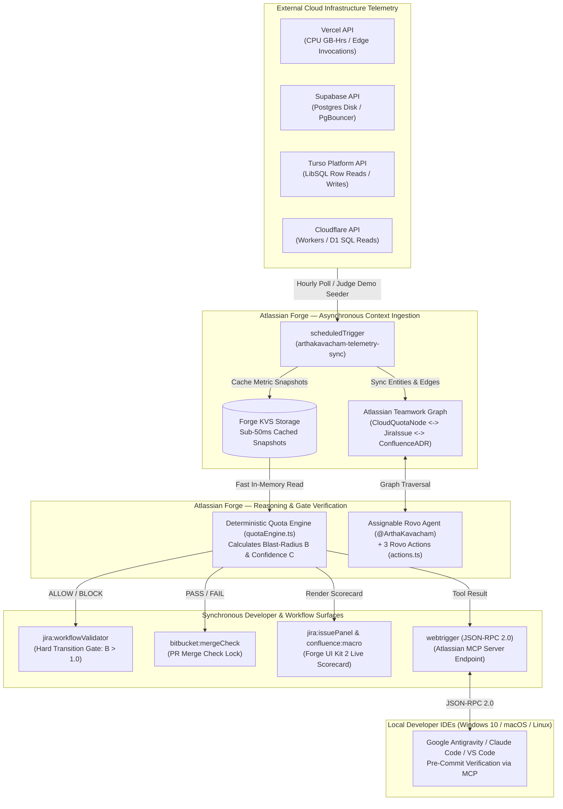

# 🛡️ ArthaKavacham (अर्थकवचम्)
> **Active FinOps & Regulatory Compliance Shield on Atlassian Forge**  
> *Codegeist 2026: Build with context. Ship with confidence.*

[](https://developer.atlassian.com/platform/forge/)
[](https://www.atlassian.com/software/rovo)
[](https://modelcontextprotocol.io/)
[](https://www.typescriptlang.org/)
[](LICENSE)

## Current implementation status

Phase 2 includes deterministic boundary fixes, shared KVS snapshots, measured-remediation verification, Jira/Confluence adapters, Teamwork Graph membership lookup, automated tests and an isolated judge CLI. Run `npm run demo` for the BLOCK → remediation simulation → ALLOW flow. See [setup, limitations and verification](docs/phase2.md) before activating integrations. Live provider collectors and installed-site validation remain outstanding; the architecture below describes the intended full system.

---

## 📌 Executive Summary

Modern software engineering teams build on elastic, consumption-priced serverless tiers—including **Vercel** (CPU execution, edge invocations), **Supabase** (Postgres storage, connection pools), **Turso** (LibSQL row reads/writes), and **Cloudflare** (Workers invocations, D1 rows). While sprint planning, architectural decisions, and pull requests live in **Jira**, **Confluence**, and **Bitbucket**, live cloud infrastructure consumption and compliance governance reside in disconnected silos.

Traditional FinOps tools are passive dashboards that alert teams *after* a quota is breached or an invoice explodes. **ArthaKavacham** (*Artha* = Capital/Resource, *Kavacham* = Armor/Shield) shifts FinOps and compliance left into the developer's core workflow by acting as an **active, deterministic pre-merge and pre-transition gatekeeper** natively hosted on **Atlassian Forge**.

---

## 🏆 Targeted Codegeist 2026 Prize Tracks

| Track | Identifier | Implementation in ArthaKavacham |
| :--- | :--- | :--- |
| **Primary Category** | Apps for Software Teams | Active FinOps guardrail embedded across Jira, Bitbucket, and Confluence. |
| **Bonus Track 1** | Best Agents (Rovo) | Assignable Rovo Agent (`@ArthaKavacham`) + 3 Rovo Actions (`evaluate-issue-blast-radius`, `apply-quota-remediation`, `create-optimization-subtask`). |
| **Bonus Track 2** | Best Teamwork Graph App | Contextual graph mapping linking `CloudQuotaNode` to Jira issues and Confluence ADRs. |
| **Bonus Track 3** | Best App with Atlassian MCP | JSON-RPC 2.0 Webtrigger endpoint enabling local IDEs (Claude Code, Kiro IDE, Antigravity) to verify quotas before `git commit`. |
| **Bonus Track 4** | Best Marketplace App | Production-ready manifest, multi-tenant Forge storage, and zero-credential Judge Demo Seeder. |

---

## 📐 Mathematical Verification Engine

ArthaKavacham eliminates non-deterministic LLM hallucinations by calculating deterministic quota blast-radius scores in `src/math/quotaEngine.ts`:

### 1. Quota Blast-Radius ($\mathcal{B}$)
$$\mathcal{B}_i = \frac{U_i(t) + \Delta \hat{U}_i \cdot \lambda_i}{Q_i \cdot \tau_i}$$
$$\mathcal{B} = \max_{i \in \{1 \dots N\}} \mathcal{B}_i$$

* $U_i(t)$: Current usage for cloud dimension $i$.
* $\Delta \hat{U}_i$: Projected consumption delta introduced by the issue/PR.
* $\lambda_i$: Sensitivity multiplier ($\lambda_i \ge 1.0$, default $1.1$ for traffic spikes).
* $Q_i$: Hard provider tier ceiling.
* $\tau_i$: Safety threshold ceiling ratio ($0 < \tau_i \le 1.0$, e.g., $0.85$ for Turso, $0.80$ for Vercel/Supabase).

### 2. Regulatory Compliance Indicator ($\mathbb{I}_{\text{comp}}$)
$$\mathbb{I}_{\text{comp}} = \begin{cases} 1 & \text{if all cloud services approved \& ADR signed} \\ 0 & \text{otherwise} \end{cases}$$

### 3. Confidence Index ($\mathcal{C}$)
$$\mathcal{C} = \mathbb{I}_{\text{comp}} \cdot \max(0, 1 - \mathcal{B})$$

### 4. Gate Decision Rule
$$\text{Decision} = \begin{cases} \mathbf{ALLOW} & \text{if } \mathcal{B} \le 1.0 \land \mathbb{I}_{\text{comp}} = 1 \\ \mathbf{BLOCK} & \text{if } \mathcal{B} > 1.0 \lor \mathbb{I}_{\text{comp}} = 0 \end{cases}$$

---

## 🏛️ System Topology



---

## 📦 Atlassian Forge Modules (`manifest.yml`)

| Module Type | Key / Identifier | Role |
| :--- | :--- | :--- |
| `jira:workflowValidator` | `arthakavacham-quota-gate` | Synchronously blocks issue transition to *Done* or *Release* when $\mathcal{B} > 1.0$. |
| `jira:issuePanel` | `arthakavacham-finops-panel` | Interactive UI Kit 2 table rendering live provider loads, lozenges, and blast-radius badges. |
| `bitbucket:mergeCheck` | `arthakavacham-pr-merge-gate` | Pull Request gate preventing merge if diff exceeds resource ceilings. |
| `confluence:macro` | `arthakavacham-adr-policy-macro` | Embeds real-time quota guardrail policies inside Architecture Decision Records (ADRs). |
| `rovo:agent` | `arthakavacham-agent` | Assignable AI FinOps teammate (`@ArthaKavacham`) with autonomous remediation skills. |
| `rovo:action` | `evaluate-issue-blast-radius` | Evaluates issue consumption against Vercel, Supabase, Turso, and Cloudflare quotas. |
| `rovo:action` | `apply-quota-remediation` | Applies architectural fixes (e.g. edge caching, connection pooling) to unblock issues. |
| `rovo:action` | `create-optimization-subtask` | Automatically creates actionable Jira subtasks for engineers. |
| `webtrigger` | `arthakavacham-mcp-endpoint` | Model Context Protocol (MCP) JSON-RPC 2.0 server for local IDE agents. |
| `scheduledTrigger` | `arthakavacham-telemetry-sync` | Background hourly sync polling cloud providers and populating Forge KVS. |

---

## 🧪 Zero-Credential Judge Demo Seeder

To allow hackathon judges and evaluators to test **ArthaKavacham** instantly without providing live third-party cloud API credentials, the project includes a deterministic **Judge Demo Seeder** in `src/telemetry/cloudProviders.ts`:

* **Turso:** Current: 650M reads / 1B limit ($\tau = 0.85$, SafeMax = 850M). Projected Delta = 266.8M with $\lambda = 1.1 \rightarrow$ **$\mathcal{B} = 1.11$ (111% breach!)**.
* **Vercel:** Current: 60 GB-Hrs / 100 limit ($\tau = 0.80$, SafeMax = 80 GB-Hrs) $\rightarrow$ Active warning.
* **Supabase:** Current: 300 MB / 500 MB limit ($\tau = 0.80$, SafeMax = 400 MB) $\rightarrow$ Active warning.
* **Cloudflare:** Current: 6M / 10M limit ($\tau = 0.80$, SafeMax = 8M) $\rightarrow$ Healthy.

---

## 🚀 Quickstart & Development Guide

### Prerequisites
* **Node.js:** `v20.x` or higher
* **Atlassian Forge CLI:** `npm install -g @forge/cli`
* **Docker:** Required for `forge tunnel` local runtime testing

### 1. Clone & Install Dependencies
```bash
git clone https://github.com/AvvarIManju-Technologies/ArthaKavacham.git
cd ArthaKavacham
npm install
```

### 2. Build TypeScript Codebase
```bash
npm run build
```

### 3. Log In & Register Forge App
```bash
forge login
forge register
```

### 4. Deploy to Development Environment
```bash
forge deploy -e development
```

### 5. Install App to Jira & Confluence Cloud
```bash
forge install --product jira --site your-site.atlassian.net
forge install --product confluence --site your-site.atlassian.net
```

### 6. Local Development Tunneling
```bash
forge tunnel
```

### 7. Connect Local IDE via MCP Webtrigger
Retrieve the Forge webtrigger endpoint:
```bash
forge webtrigger
```
Add to your IDE MCP configuration (`.agents/mcp_config.json`):
```json
{
  "mcpServers": {
    "arthakavacham": {
      "url": "https://<forge-webtrigger-url>/arthakavacham-mcp-endpoint",
      "transport": "http"
    }
  }
}
```

---

## 📂 Project Directory Structure

```
ArthaKavacham/
├── package.json                   # Forge Node 20 & UI Kit 2 dependencies
├── tsconfig.json                  # CommonJS React-JSX TypeScript configuration
├── manifest.yml                   # Complete Forge multi-module declaration
├── REQUIREMENTS.md                # Problem statement & hackathon specifications
├── ARCHITECTURE.md                # System topology & data flow blueprint
├── SKILLS.md                      # Rovo action contracts & MCP tool schemas
├── TECHNICAL_STACK.md             # Stack specs, scopes, and Windows 10 tooling
├── README.md                      # Project documentation (this file)
└── src/
    ├── index.ts                   # Export registry for all Forge function handlers
    ├── types.ts                   # Core domain interfaces, metrics & RPC models
    ├── math/
    │   └── quotaEngine.ts         # Deterministic mathematical verification engine
    ├── telemetry/
    │   └── cloudProviders.ts      # Cloud telemetry & Judge Demo Seeder
    ├── validators/
    │   └── jiraWorkflowValidator.ts # Jira workflow validator & Bitbucket merge gate
    ├── rovo/
    │   └── actions.ts             # Rovo agent handlers (evaluate, remediate, subtask)
    ├── mcp/
    │   └── mcpServer.ts           # JSON-RPC 2.0 Atlassian MCP webtrigger server
    └── ui/
        └── issuePanel.tsx         # Forge UI Kit 2 FinOps Scorecard & ADR macro
```

---

## 📄 License & Attribution

* **Organization:** AvvarIManju Technologies
* **Architect & Developer:** Manjunath Venkata Avvari
* **License:** Apache License 2.0 — see [LICENSE](LICENSE) for details.
